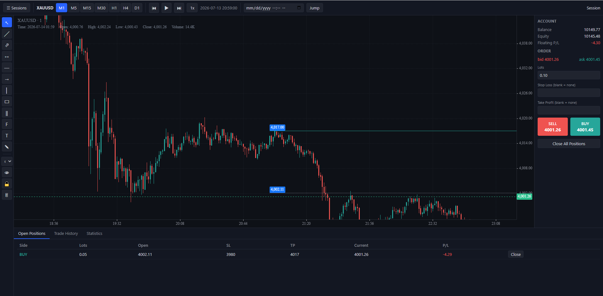

# Trading Wiev — XAUUSD Bar Replay & Backtester

[](https://www.python.org/)
[](https://fastapi.tiangolo.com/)
[](https://pandas.pydata.org/)
[](https://www.sqlite.org/)
[](https://www.typescriptlang.org/)
[](https://vitejs.dev/)
[](https://klinecharts.com/)
[](https://www.docker.com/)

A local, self-hosted bar-replay and manual backtesting tool for XAUUSD (or any
CSV-importable symbol), modeled on TradingView's Bar Replay: pick a past
date, hide the future, step forward/back bar by bar, draw on the chart, and
place simulated buy/sell trades with SL/TP.

No indicators, no automated strategies, no live broker connection, no user
accounts — this is a single-user, single-process local tool.



Built by [AnonimTM1](https://github.com/AnonimTM1).

## Quick start

```bash
docker compose up --build
```

Then open **http://localhost:8000**. That's it — no other manual steps.

All data (imported price history, sessions, trades, drawings) is stored under
`./data`, which is bind-mounted into the container, so it survives rebuilds
and restarts.

## Importing data

The app needs price history before you can start a replay session. The
"Import data…" screen has two modes:

1. **Download data** — fetches free, public historical tick data directly
   from Dukascopy (no API key, no account needed) and aggregates it into M1
   bars in the background. Pick a symbol (majors, XAUUSD/XAGUSD, BTCUSD/ETHUSD
   are supported out of the box) and a date range; progress is polled and
   shown live. Multi-year ranges can take several minutes since it's
   downloading real tick history hour by hour. This is the easiest way to get
   started — no manual file wrangling needed.
2. **Manual upload** — for your own CSV exports: drop files in
   `./data/raw/` and import them (or `POST /api/import/raw/{filename}`), or
   upload a file directly through the UI.

### Supported CSV formats (auto-detected)

- **MT5 History Center export** (tab-separated):
  `<DATE>\t<TIME>\t<OPEN>\t<HIGH>\t<LOW>\t<CLOSE>\t<TICKVOL>\t<VOL>\t<SPREAD>`,
  dates like `2024.01.02`.
- **Generic CSV**: `time,open,high,low,close[,volume][,spread]`, with `time`
  as ISO-8601 or Unix seconds.

The symbol name comes from the filename (e.g. `XAUUSD_2024.csv` → `XAUUSD`)
or an explicit `symbol` field/query param if you provide one. Per-symbol
settings (point size, contract size, default spread in points, display
timezone) are editable afterward via `PUT /api/symbols/{symbol}`.

On import, rows are validated (sorted timestamps, no duplicates,
`high >= max(open, close)`, `low <= min(open, close)`); invalid rows are
rejected and reported (not silently dropped), the rest are converted to
Parquet at `./data/parquet/{SYMBOL}/M1.parquet`. Higher timeframes (M5, M15,
M30, H1, H4, D1) are resampled from M1 on demand and cached in memory.

### Getting data out of MetaTrader 5

`tools/export_mt5.py` is a **standalone script you run on your Windows
host, outside Docker** (the `MetaTrader5` Python package only works on
Windows and only talks to a locally running MT5 terminal — it cannot run
inside the Linux container, so it plays no part in `docker compose up`).

```powershell
pip install MetaTrader5 pandas
python tools/export_mt5.py --symbol XAUUSD --from 2021-01-01 --to 2024-01-01
```

This writes a generic-format CSV (including MT5's historical spread column)
into `./data/raw/`, ready to import from the app's Import screen.

## Replay controls

- Step forward / step back one bar, play / pause
- Speed selector from 1x to 300x steps per second. Above ~25 steps/s, steps
  are batched into one request so the effective speed still matches, and
  each tick waits for the previous one, so playback never stutters or skips
  updates
- **Step resolution**: by default one step equals one bar of the chart's
  timeframe (like TradingView). Choose e.g. *Step: M1* while viewing H1 to
  watch the H1 candle form minute by minute
- Gaps in the data (weekends, daily breaks, missing minutes) are skipped
  automatically, so playback doesn't stall
- The chart follows the newest bar while it's in view; if you scroll back
  into history it stays put (⇥ / `End` returns to the latest bar)
- Jump to a specific date (asks for confirmation if positions or pending
  orders are open, since fills are not simulated across a skipped range)
- Indicators (MA, EMA, Bollinger, Parabolic SAR, Volume, MACD, RSI, KDJ).
  They are computed only from the bars up to the cursor, so they never peek
  at future data
- Timeframe, speed, step resolution, indicators, lot size and risk % are
  remembered between visits

**Keyboard shortcuts:**

| Key            | Action                    |
| -------------- | ------------------------- |
| `Shift + →`    | Step forward              |
| `Shift + ←`    | Step back                 |
| `Space`        | Play / pause              |
| `+` / `-`      | Faster / slower           |
| `1` … `7`      | M1, M5, M15, M30, H1, H4, D1 |
| `End`          | Scroll to latest bar      |
| `Esc`          | Cancel drawing tool       |
| `Alt + B`      | Buy                       |
| `Alt + S`      | Sell                      |
| `Alt + X`      | Close all positions       |

Step back only moves the cursor for viewing. It does not undo executed
trades, and it is disabled while any position is open.

## Drawing tools

Left toolbar, grouped: trend line, ray, extended line, arrow · horizontal
line, horizontal ray (one click, always extends right), vertical line ·
rectangle, parallel channel, Fibonacci retracement · **Long / Short position**
and **Measure** · text, brush.

- **Long/Short position**: one click sets the entry. TP and SL start at a
  default distance and can be dragged by their handles; the boxes show
  target/stop in price, % and points plus R:R. **Use as order** copies
  entry/SL/TP into the order ticket and picks market, limit or stop.
- **Measure**: price change, %, points, bar count and duration between two
  points.
- **Selected drawing toolbar**: click a drawing to change its colour, line
  width, line style, lock it, edit text (or double-click), or delete it
  (`Del`). New drawings use the last colour you picked.
- Magnet (off / weak / strong snap to OHLC), *stay in drawing mode*,
  hide-all, lock-all, delete-all.
- `Esc` cancels an unfinished drawing. Alt shortcuts: `T` trend, `A` arrow,
  `H` horizontal line, `J` horizontal ray, `V` vertical line, `R` rectangle,
  `F` Fibonacci, `L` long, `K` short, `M` measure, `N` text.
- Drawings are saved per symbol and shared across sessions and timeframes.

## Trading simulation

- Market, **limit** and **stop** orders with lot size and optional SL/TP,
  multiple simultaneous positions.
- **Risk %** sizing: enter a risk % and an SL and the lot size is computed so
  that hitting the SL loses that % of the balance. The panel shows risk,
  reward and R:R before you place the order.
- Bars are BID prices (MT5 convention): `ask = bid + spread`. A long enters
  at ask / exits at bid; a short enters at bid / exits at ask. Per-bar spread
  from the data is used when present, otherwise the symbol's configured
  default.
- Market orders fill at the close of the cursor's M1 bar, spread applied.
- SL/TP on the wrong side of the market (e.g. a buy SL above the bid) are
  rejected, like MT5's "invalid stops".
- SL/TP are checked against every M1 bar crossed during a step, on the
  correct bid/ask side for the position's direction. If both are touched
  within the same bar, SL is assumed hit first. If a bar opens beyond SL/TP
  (a gap), the fill is at the open price, not the SL/TP level.
- Pending orders trigger on the side they execute on (buy orders on the ask,
  sell orders on the bid). A limit order fills at its price, or at the open
  if the bar gaps through it. A stop order fills at its price, or at the gap
  open (slippage). A position opened by a pending order is checked for SL/TP
  from the next M1 bar.
- Drag SL/TP lines and pending-order lines directly on the chart; close
  positions, cancel orders individually, or close all at once.

## Statistics

Total trades, win rate, net P/L, return %, profit factor, expectancy,
average win/loss, largest win/loss, average R (for trades with an SL set),
max drawdown (absolute and %), longest win/loss streaks, long vs. short
breakdown, and an equity curve, all in the Statistics tab. Trade history is
exportable to CSV.

## Development

Run the backend test suite (pure-Python engine tests need no server; API
tests spin up FastAPI in-process):

```bash
cd backend
python -m venv .venv && .venv/Scripts/activate  # or source .venv/bin/activate
pip install -r requirements.txt
pytest
```

Frontend dev server (proxies `/api` to a backend running on `:8000`):

```bash
cd frontend
npm install
npm run dev
```

## Project structure

```
backend/app/{main.py, api/, engine/, data/, db/}   FastAPI app, trading engine, CSV/parquet/resample, SQLAlchemy models
backend/tests/                                      pytest suite (engine, resample, CSV import, API)
frontend/src/{chart/, replay/, trading/, drawings/, ui/}   Vite + TS + KLineChart frontend
tools/export_mt5.py                                 Windows-only MT5 export helper (not used in Docker)
data/                                                bind-mounted volume: raw/, parquet/, app.db (gitignored)
Dockerfile, docker-compose.yml                       single service on :8000
```

## Decisions

Ambiguities in the spec were resolved as follows, simplest-reasonable-option
first:

- **New-symbol defaults**: well-known instruments (XAUUSD, XAGUSD, FX
  majors, USDJPY, BTCUSD, ETHUSD) get broker-like presets for point size,
  contract size and spread. Anything else gets point size 0.01, contract
  size 100, spread 20 points. Timezone is UTC. All of these can be edited
  per symbol from the ⚙ settings dialog.
- **Chart time**: timestamps are naive broker time and the chart renders
  them in UTC, so a bar's label matches the data no matter what the
  browser's local timezone is.
- **D1 boundary & timezone**: imported timestamps are treated as naive
  "broker time". For D1 resampling, that time is interpreted in the
  symbol's configured timezone to align daily boundaries to local midnight;
  M5/M15/M30/H1/H4 buckets are fixed-length and timezone-independent (this
  matches MT5/TradingView wall-clock bars, which don't shift with timezone).
- **Partial replay candle correctness**: the "no future data" guarantee and
  the partial-last-candle behavior both fall out of one rule — closed
  buckets are served from a resample of the *entire* M1 series (safe,
  because a closed bucket's own end time is always ≤ any cursor that has
  fully passed it), while the still-forming bucket is always recomputed
  fresh from only the M1 rows at-or-before the cursor.
- **"Step forward/back n bars of tf"**: defined as crossing exactly `n`
  timeframe-bucket boundaries from wherever the cursor currently sits
  (including completing a currently-partial bucket as the first step), with
  every M1 bar in between run through the fill/SL/TP engine in order.
- **Jump-to-date**: relocates the cursor directly without simulating fills
  across the skipped range (this is why it asks for confirmation only when
  positions are open — jumping is a "viewing" operation, not a fast-forward
  through the engine).
- **Gap fill price for shorts**: since a short's stop/take-profit are
  evaluated on the ask side, a gap is measured and filled at
  `bar.open + spread`, not the raw bid open.
- **Max drawdown**: reported as an absolute currency value over the
  closed-trade equity curve (not a percentage).
- **Trade history / drawings identity**: drawings are persisted per-symbol
  (shared across all sessions/timeframes on that symbol) as specified;
  trades and positions are scoped per-session.
- **Dukascopy download (added after the initial build, at the user's
  request, alongside manual upload)**: implemented server-side against
  Dukascopy's public `datafeed.dukascopy.com` tick archive (no API key). The
  hourly `.bi5` URL scheme, its LZMA-compressed big-endian tick record layout,
  and the per-instrument price-scale divisors were verified against existing
  open-source Dukascopy-datafeed reference implementations rather than
  assumed, since Dukascopy does not publish this format officially. Ticks are
  aggregated into M1 bid-price bars with spread derived from the ask-bid
  difference, converted into "points" via the symbol's configured point
  size, then merged into the same parquet store manual imports use — so nothing
  downstream (replay, engine, resampling) distinguishes downloaded vs.
  uploaded data. Downloads run as a background task tracked in a
  `download_jobs` table so the UI can poll progress; only a fixed set of
  common instruments has a known price scale out of the box (see
  `GET /api/import/dukascopy/symbols`) — others need `pipet_scale` passed
  explicitly to `POST /api/import/download`.
- **KLineChart version**: the spec asked for "latest stable from npm" —
  at the time of building this was `10.0.3` (the v10 line moved out of beta
  during development), verified against that version's actual TypeScript
  source rather than assumed from memory. Its `klinecharts` package does not
  export `KLineData`/`Period` as named types from the root module, so the
  frontend declares small structural-equivalent local types instead of
  importing them.

## Known limitations

- Partial close and the long/short position drawing tool are not built yet.
