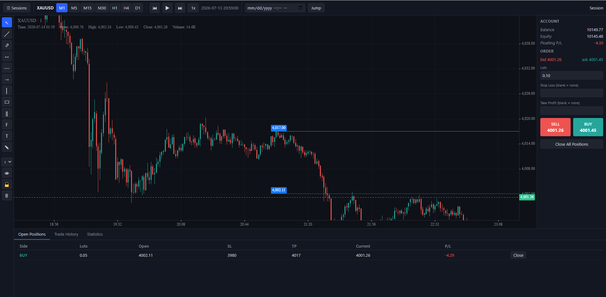

# Trading Wiev — XAUUSD Bar Replay & Backtester

[](https://www.python.org/)
[](https://fastapi.tiangolo.com/)
[](https://pandas.pydata.org/)
[](https://www.sqlite.org/)
[](https://www.typescriptlang.org/)
[](https://vitejs.dev/)
[](https://klinecharts.com/)
[](https://www.docker.com/)

A local, self-hosted bar-replay and manual backtesting tool for XAUUSD (or any
CSV-importable symbol), modeled on TradingView's Bar Replay: pick a past
date, hide the future, step forward/back bar by bar, draw on the chart, and
place simulated buy/sell trades with SL/TP. A **Live mode** shows real-time
MetaTrader 5 prices with paper trading, and an **economic calendar**
(ForexFactory) appears on the chart in both modes.

No automated strategies, no orders sent to a broker, no user accounts. This is
a single-user local tool.

### ⬇️ [Download TradingWiev.exe (Windows)](https://drive.google.com/file/d/1rnuI_nfMsegFcgbqM3WwEFpSQb3_iUVs/view?usp=sharing)

One file, no install, no Docker or Python needed. See [Desktop app](#desktop-app-windows-exe).



Built by [AnonimTM1](https://github.com/AnonimTM1).

## What's new

**Live mode (MetaTrader 5)**, paper trading on real prices:
- Real-time MT5 chart with drawings, positions, SL/TP, pending orders, news
  and statistics. **No orders are sent to MT5.** The bridge is read-only.
- Searchable picker over every MT5 symbol, with Market Watch symbols first.
- Every tick between polls goes through SL/TP and pending-order checks.
  Ticks from while the app was closed are processed too, up to 7 days back.
- Stays connected while MT5 downloads history. The app keeps the last known
  price and shows **MT5 busy…** instead of disconnecting.
- Broker server time is converted to UTC automatically, including DST.

**Offline data from MT5**:
- *Import data… → From MetaTrader 5* copies M1 history from your MT5
  terminal into the local store, so replay works with MT5 closed. In testing,
  2 years of XAUUSD (about 700k bars) imported in about 11 seconds.
- Bars keep MT5's own per-bar spread, and a new symbol takes the broker's
  point and contract size.
- **Keep updated automatically**: while MT5 is open, registered symbols are
  topped up with new bars every 5 minutes.

**Desktop app**: `TradingWiev.exe` with no Docker or Python needed. It has
the MT5 bridge built in and a candlestick icon. See *Desktop app* below.

**Economic calendar**:
- Historical ForexFactory calendar included in
  `data/news/forexfactory_news.csv`.
- This week's calendar is fetched live from ForexFactory for live sessions.
- High and Medium events are marked at the bottom of the chart, with a News
  tab and a countdown chip for the next high-impact release.
- In replay, the actual value stays hidden until the cursor reaches the
  release. Replay can also pause before high-impact news.

**Trading**:
- Drag SL/TP lines on the chart. Drag a position's entry line to add SL or
  TP. Values can still be typed in the table.

**Drawing tools**:
- Consistent SVG icons and a grouped toolbar.
- One-click horizontal ray that always extends right.
- New tools: arrow, text label, measure, and long/short position with
  **Use as order**.
- Configurable **Fibonacci retracement**: levels, colours, extend, labels,
  fill, reverse.
- **Gann box** with Gann angles.
- Style bar for the selected drawing: colour, width, line style, lock, edit,
  delete. `Del` also deletes it.
- Magnet, *stay in drawing mode*, and Alt hotkeys.

**ICT analysis**:
- **Kill zones** in New York time, DST-aware, with editable sessions.
- **Order block finder** and **FVG finder**.
- Click a tool's toolbar button to show or hide it. Right-click it, or use
  ⚙ / ✕ next to its name on the chart, for settings or to remove it.

**Chart & layout**:
- **Chart appearance** (🎨 in the top bar):
  - presets: Dark, TradingView, Midnight blue, Monochrome, Light;
  - candle style: candles, hollow, OHLC bars, line/area;
  - colours for body, border and wick, background, grid, text, axis lines
    and crosshair;
  - toggles for the last-price line, high/low marks and the countdown.

  Changes apply live and are remembered.
- **Candle close countdown** under the last price on the price scale, on
  every timeframe, like TradingView. Live mode counts down to the real close.
  Replay counts down from the replay cursor. Nothing is shown once the bar's
  close has passed, for example when the market is closed.
- **Resizable bottom panel** (positions, history, statistics, news):
  - drag its top edge to resize it;
  - ▁ minimises it to the tab strip, and clicking a tab restores it;
  - ▢ maximises it;
  - double-clicking the edge toggles minimise and restore.

  The size and state are remembered.
- **Collapsible account panel** on the right: » minimises it to a thin strip
  that still shows equity and floating P/L. Click the strip to bring it back.

**Fixes**:
- Dukascopy downloads silently dropped rate-limited hours (`429`). In one
  test, only 5 of 24 hours arrived. Downloads now wait as the server asks
  and retry. Hours that still fail are reported, so you can run the download
  again to fill the gaps.
- Black screen on load.
- Unreadable Fibonacci labels.
- Measure drawings that couldn't be selected or deleted.
- "Ghost" drawings saved without time coordinates.
- Wrongly pointing trade markers and arrows.

## Quick start

```bash
docker compose up --build
```

Then open **http://localhost:8000**. That's it — no other manual steps.

All data (imported price history, sessions, trades, drawings) is stored under
`./data`, which is bind-mounted into the container, so it survives rebuilds
and restarts.

## Desktop app (Windows .exe)

`TradingWiev.exe` is the whole app in one file. You don't need Docker or
Python.

**Download:** [TradingWiev.exe on Google Drive](https://drive.google.com/file/d/1rnuI_nfMsegFcgbqM3WwEFpSQb3_iUVs/view?usp=sharing)
(about 67 MB; Google Drive may say it can't scan the file for viruses
because it is large — choose *Download anyway*).

1. Put `TradingWiev.exe` in a folder of its own, for example
   `C:\TradingWiev\`.
2. Double-click it. A console window opens, the app starts on a free local
   port and your browser opens it. **Close the console window to quit.**
3. Everything is stored in a **`data` folder next to the exe**: imported or
   downloaded bars, sessions, drawings and the news calendar. To update,
   replace the exe and keep the `data` folder. To move the app, move the
   whole folder.

More details:

- The first start takes a few seconds, because a one-file exe unpacks itself
  first.
- **Live mode** works out of the box when MetaTrader 5 is installed, because
  the read-only MT5 bridge is built into the exe. MT5 must be open and logged
  in; the app never launches MT5 by itself. If a bridge is already running
  (for example `start-mt5-bridge.bat`), the exe uses it.
- Starting the exe while it is already running just opens the browser again.
- It uses port 8000, or the next free port if a Docker copy is already using
  8000.
- Windows SmartScreen may warn on first run because the exe isn't signed.
  Choose *More info → Run anyway*.

Building it yourself (Windows):

```bat
backend\.venv\Scripts\python.exe -m pip install pyinstaller MetaTrader5 pillow
backend\.venv\Scripts\python.exe desktop\build_exe.py
```

This builds the frontend (with npm if installed, otherwise Docker), draws the
icon (`desktop/make_icon.py`) and runs PyInstaller with
`desktop/TradingWiev.spec`. The output is `dist\TradingWiev.exe`.

## Importing data

The app needs price history before you can start a replay session. The
"Import data…" screen has two modes:

1. **Download data** — fetches free, public historical tick data directly
   from Dukascopy (no API key, no account needed) and aggregates it into M1
   bars in the background. Pick a symbol (majors, XAUUSD/XAGUSD, BTCUSD/ETHUSD
   are supported out of the box) and a date range; progress is polled and
   shown live. Multi-year ranges can take several minutes since it's
   downloading real tick history hour by hour. This is the easiest way to get
   started — no manual file wrangling needed.
2. **Manual upload** — for your own CSV exports: drop files in
   `./data/raw/` and import them (or `POST /api/import/raw/{filename}`), or
   upload a file directly through the UI.

### Supported CSV formats (auto-detected)

- **MT5 History Center export** (tab-separated):
  `<DATE>\t<TIME>\t<OPEN>\t<HIGH>\t<LOW>\t<CLOSE>\t<TICKVOL>\t<VOL>\t<SPREAD>`,
  dates like `2024.01.02`.
- **Generic CSV**: `time,open,high,low,close[,volume][,spread]`, with `time`
  as ISO-8601 or Unix seconds.

The symbol name comes from the filename (e.g. `XAUUSD_2024.csv` → `XAUUSD`)
or an explicit `symbol` field/query param if you provide one. Per-symbol
settings (point size, contract size, default spread in points, display
timezone) are editable afterward via `PUT /api/symbols/{symbol}`.

On import, rows are validated (sorted timestamps, no duplicates,
`high >= max(open, close)`, `low <= min(open, close)`); invalid rows are
rejected and reported (not silently dropped), the rest are converted to
Parquet at `./data/parquet/{SYMBOL}/M1.parquet`. Higher timeframes (M5, M15,
M30, H1, H4, D1) are resampled from M1 on demand and cached in memory.

### Importing directly from MetaTrader 5

With MT5 open and logged in, and the bridge running (it's built into the exe,
or use `start-mt5-bridge.bat` with Docker):

1. Go to *Import data… → From MetaTrader 5*.
2. Pick the MT5 symbol and a date range. The 1M/3M/6M/1Y/2Y buttons set
   common ranges.
3. Optionally rename the local symbol, then click *Import from MT5*.

The import runs in two-week chunks with a progress bar, and imports merge, so
overlapping ranges don't duplicate bars.

How much M1 history MT5 can return is limited by its *Tools → Options →
Charts → Max bars in chart* setting. If it returns less than you asked for,
the app tells you to raise that setting and import again.

Tick *Keep this symbol updated automatically* to register the symbol. Every
5 minutes, while MT5 is reachable, the app fetches bars from the last stored
one up to now. The list of auto-updated symbols is in the same tab, with
*Update now* and *Remove*. It is saved in `data/mt5_autosync.json`.

### Getting data out of MetaTrader 5

`tools/export_mt5.py` is a **standalone script you run on your Windows
host, outside Docker** (the `MetaTrader5` Python package only works on
Windows and only talks to a locally running MT5 terminal — it cannot run
inside the Linux container, so it plays no part in `docker compose up`).

```powershell
pip install MetaTrader5 pandas
python tools/export_mt5.py --symbol XAUUSD --from 2021-01-01 --to 2024-01-01
```

This writes a generic-format CSV (including MT5's historical spread column)
into `./data/raw/`, ready to import from the app's Import screen.

## Replay controls

- Step forward / step back one bar, play / pause
- Speed selector from 1x to 300x steps per second. Above ~25 steps/s, steps
  are batched into one request so the effective speed still matches, and
  each tick waits for the previous one, so playback never stutters or skips
  updates
- **Step resolution**: by default one step equals one bar of the chart's
  timeframe (like TradingView). Choose e.g. *Step: M1* while viewing H1 to
  watch the H1 candle form minute by minute
- Gaps in the data (weekends, daily breaks, missing minutes) are skipped
  automatically, so playback doesn't stall
- The chart follows the newest bar while it's in view; if you scroll back
  into history it stays put (⇥ / `End` returns to the latest bar)
- Jump to a specific date (asks for confirmation if positions or pending
  orders are open, since fills are not simulated across a skipped range)
- Indicators (MA, EMA, Bollinger, Parabolic SAR, Volume, MACD, RSI, KDJ).
  They are computed only from the bars up to the cursor, so they never peek
  at future data
- Timeframe, speed, step resolution, indicators, lot size and risk % are
  remembered between visits

**Keyboard shortcuts:**

| Key            | Action                    |
| -------------- | ------------------------- |
| `Shift + →`    | Step forward              |
| `Shift + ←`    | Step back                 |
| `Space`        | Play / pause              |
| `+` / `-`      | Faster / slower           |
| `1` … `7`      | M1, M5, M15, M30, H1, H4, D1 |
| `End`          | Scroll to latest bar      |
| `Esc`          | Cancel drawing tool       |
| `Alt + B`      | Buy                       |
| `Alt + S`      | Sell                      |
| `Alt + X`      | Close all positions       |

Step back only moves the cursor for viewing. It does not undo executed
trades, and it is disabled while any position is open.

## Drawing tools

Left toolbar, grouped: trend line, ray, extended line, arrow · horizontal
line, horizontal ray (one click, always extends right), vertical line ·
rectangle, parallel channel, Fibonacci retracement · **Long / Short position**
and **Measure** · text, brush.

- **Long/Short position**: one click sets the entry. TP and SL start at a
  default distance and can be dragged by their handles; the boxes show
  target/stop in price, % and points plus R:R. **Use as order** copies
  entry/SL/TP into the order ticket and picks market, limit or stop.
- **Measure**: price change, %, points, bar count and duration between two
  points.
- **Selected drawing toolbar**: click a drawing to change its colour, line
  width, line style, lock it, edit text (or double-click), or delete it
  (`Del`). New drawings use the last colour you picked.
- Magnet (off / weak / strong snap to OHLC), *stay in drawing mode*,
  hide-all, lock-all, delete-all.
- **Fibonacci retracement** (configurable): double-click it or use ⚙ in the
  drawing toolbar to enable/disable levels, change values and colours, add
  your own levels, extend left/right, show prices/levels, labels left or
  right, background fill, reverse, single colour. The last settings you used
  become the default for new Fibonacci drawings.
- **Gann box**: price × time grid with Gann angles from the start corner;
  levels, angles, fill, labels and reverse are configurable the same way.
- `Esc` cancels an unfinished drawing. Alt shortcuts: `T` trend, `A` arrow,
  `H` horizontal line, `J` horizontal ray, `V` vertical line, `R` rectangle,
  `F` Fibonacci, `G` Gann box, `L` long, `K` short, `M` measure, `N` text.
- Drawings are saved per symbol and shared across sessions and timeframes.

### ICT analysis tools

Toolbar buttons below the drawing tools. Click to show or hide, right-click for
settings. They only use the bars loaded on the chart, so in replay they never
see the future.

- **Kill zones**: Asia 20:00–00:00, London 02:00–05:00 and NY AM 07:00–10:00
  are on by default; London Close 10:00–12:00 and NY PM 13:30–16:00 are off.
  Times are **New York time**, and daylight saving is handled automatically.
  Each zone is drawn as a box around the session's high and low, or as a
  full-height band. You can edit the times, names and colours. Shown on
  timeframes up to H1. Chart times are treated as UTC, which matches
  Dukascopy and MT5 Live data.
- **Order block finder**: on a break of structure (a close beyond the last
  swing high or low, with swing length N bars on each side), the order block
  is the last opposite candle of the leg. A block is shown as touched once
  price comes back into it. It is broken when a candle closes through it.
  Settings: swing length, blocks per side, show broken blocks, extend,
  colours.
- **FVG finder**: three-candle imbalances, where candle 3's low is above
  candle 1's high (bullish) or the reverse (bearish). Gaps smaller than a
  multiple of ATR(14) are filtered out. A gap ends when price fully fills it.
  Options: the 50% line (consequent encroachment), show filled gaps, how many
  to keep, colours.

## Live mode (MetaTrader 5)

Real-time MT5 prices with **paper trading**. Positions, SL/TP, pending
orders, drawings, news and statistics all work as in replay, but **no orders
are sent to your MT5 account**. The bridge is read-only and has no
order-sending code.

1. Open MetaTrader 5 and log in. A demo account is fine.
2. Double-click **`start-mt5-bridge.bat`**. The first run creates a Python
   environment and installs `MetaTrader5`. Keep the window open.
3. In the app, open ☰. Under **Live (MetaTrader 5)**, pick a symbol from
   Market Watch and click **Start Live**.

How it works:

- The MetaTrader5 Python package only runs on Windows, so
  `mt5bridge/bridge.py` runs on the host at `127.0.0.1:8765`. The Docker app
  reaches it at `MT5_BRIDGE_URL` (default
  `http://host.docker.internal:8765`).
- Broker server time is converted to UTC. The bridge detects the server's
  offset from live ticks and caches it. When the offset matches the common
  "NY close = 00:00" convention (UTC+2 in winter, UTC+3 in US summer), it
  applies that rule with DST changes across history. To force an offset, set
  `MT5_UTC_OFFSET=2` (hours) or `MT5_UTC_OFFSET=nyclose`.
- Every 0.5 s the app syncs the session. The backend replays every MT5 tick
  since the previous sync through the SL/TP and pending-order engine, so a
  spike through a stop between polls is not missed. Ticks from while the app
  was closed are processed when you reopen the session, up to 7 days back.
- Contract size, point size and spread come from the broker's symbol
  specification. Fills use the live bid/ask.
- **Live news**: when you open a live session, the app pulls this week's
  ForexFactory calendar from its public JSON feed
  (`nfs.faireconomy.media/ff_calendar_thisweek.json`). It pulls it again every
  30 minutes while the session is open. Events show on the chart and in the
  News tab like the CSV calendar. The two sources are merged, and when an
  event is in both, the CSV row wins because it can include the actual value.
  The feed has times with time zones, so the UTC conversion is exact.
  - Every fetched week is kept in `data/news/ff_feed_archive.json`, so past
    weeks don't disappear when the feed moves on to the next week.
  - The feed has **no actual values**, only forecast and previous.
  - ForexFactory blocks clients that poll too often. The app fetches at most
    once every 30 minutes, at most once a minute even when forced, and waits
    as long as the server's `Retry-After` header says.
- The first time you open a symbol or timeframe, MT5 may download its history
  from the broker. This can take seconds to a minute, and the whole terminal
  stalls while it does. To keep the stall from freezing the bridge, the
  bridge's HTTP process never calls MT5 itself:
  - one worker process keeps the watched quotes fresh every 100 ms;
  - a second worker process handles bars and the symbol list.

  While MT5 is busy, the app keeps the last known price. The status shows
  **MT5 busy…** in yellow, not *disconnected*. It only reports *disconnected*
  after several failed polls in a row.

## Economic calendar (news)

- **History**: the ForexFactory calendar CSV is at
  `data/news/forexfactory_news.csv` and is versioned in this repo, so the
  calendar works right after cloning. Its times are Europe/London; set
  `NEWS_TIMEZONE` for exports made in another timezone. You can replace it
  from *Import data… → Manual upload → Economic calendar*. The columns are
  `Date,Time,Day,Currency,Impact,Event,Actual,Forecast,Previous,Time_Label,Event_ID`.
- **This week (live)**: see *Live news* under Live mode. Fetched weeks are
  archived in `data/news/ff_feed_archive.json`, which is versioned too.
- **On the chart**, events are marked at the bottom of the candle pane under
  the bar of their release:
  - filled markers for released events;
  - hollow markers for upcoming ones;
  - a dashed guide line for the next High-impact event.

  Hover a marker for the details.
- **News tab** filters:
  - High, Medium and Low impact;
  - the symbol's currencies, or all currencies;
  - show on chart;
  - *pause before high-impact news*, which stops replay one minute before
    each High release.
- **No look-ahead**: in replay, the backend withholds an event's actual value
  until the cursor reaches its release time.

## Trading simulation

- Market, **limit** and **stop** orders with lot size and optional SL/TP,
  multiple simultaneous positions.
- **Risk %** sizing: enter a risk % and an SL and the lot size is computed so
  that hitting the SL loses that % of the balance. The panel shows risk,
  reward and R:R before you place the order.
- Bars are BID prices (MT5 convention): `ask = bid + spread`. A long enters
  at ask / exits at bid; a short enters at bid / exits at ask. Per-bar spread
  from the data is used when present, otherwise the symbol's configured
  default.
- Market orders fill at the close of the cursor's M1 bar, spread applied.
- SL/TP on the wrong side of the market (e.g. a buy SL above the bid) are
  rejected, like MT5's "invalid stops".
- SL/TP are checked against every M1 bar crossed during a step, on the
  correct bid/ask side for the position's direction. If both are touched
  within the same bar, SL is assumed hit first. If a bar opens beyond SL/TP
  (a gap), the fill is at the open price, not the SL/TP level.
- Pending orders trigger on the side they execute on (buy orders on the ask,
  sell orders on the bid). A limit order fills at its price, or at the open
  if the bar gaps through it. A stop order fills at its price, or at the gap
  open (slippage). A position opened by a pending order is checked for SL/TP
  from the next M1 bar.
- Drag SL/TP lines and pending-order lines directly on the chart; close
  positions, cancel orders individually, or close all at once.

## Statistics

Total trades, win rate, net P/L, return %, profit factor, expectancy,
average win/loss, largest win/loss, average R (for trades with an SL set),
max drawdown (absolute and %), longest win/loss streaks, long vs. short
breakdown, and an equity curve, all in the Statistics tab. Trade history is
exportable to CSV.

## Development

Run the backend test suite (pure-Python engine tests need no server; API
tests spin up FastAPI in-process):

```bash
cd backend
python -m venv .venv && .venv/Scripts/activate  # or source .venv/bin/activate
pip install -r requirements.txt
pytest
```

Frontend dev server (proxies `/api` to a backend running on `:8000`):

```bash
cd frontend
npm install
npm run dev
```

## Project structure

```
backend/app/{main.py, api/, engine/, data/, db/}   FastAPI app, trading engine, CSV/parquet/resample, SQLAlchemy models
backend/app/api/live.py, data/mt5_client.py         live (MT5) mode: bridge client, live sessions, tick sync
backend/app/data/news.py, data/news_feed.py         economic calendar: CSV history + weekly ForexFactory feed
backend/tests/                                      pytest suite (engine, resample, CSV import, API, live, news)
frontend/src/{chart/, replay/, live/, trading/}     chart, replay & live drivers, trading panel
frontend/src/{drawings/, analysis/, news/, ui/}     drawing tools, ICT analysis, calendar, UI
mt5bridge/bridge.py, start-mt5-bridge.bat           read-only MT5 market-data bridge (Windows host)
tools/export_mt5.py                                 Windows-only MT5 export helper (not used in Docker)
data/                                                bind-mounted volume: raw/, parquet/, app.db (gitignored);
                                                     data/news/ calendar files are versioned
Dockerfile, docker-compose.yml                       single service on :8000
```

## Decisions

Ambiguities in the spec were resolved as follows, simplest-reasonable-option
first:

- **New-symbol defaults**: well-known instruments (XAUUSD, XAGUSD, FX
  majors, USDJPY, BTCUSD, ETHUSD) get broker-like presets for point size,
  contract size and spread. Anything else gets point size 0.01, contract
  size 100, spread 20 points. Timezone is UTC. All of these can be edited
  per symbol from the ⚙ settings dialog.
- **Chart time**: timestamps are naive broker time and the chart renders
  them in UTC, so a bar's label matches the data no matter what the
  browser's local timezone is.
- **D1 boundary & timezone**: imported timestamps are treated as naive
  "broker time". For D1 resampling, that time is interpreted in the
  symbol's configured timezone to align daily boundaries to local midnight;
  M5/M15/M30/H1/H4 buckets are fixed-length and timezone-independent (this
  matches MT5/TradingView wall-clock bars, which don't shift with timezone).
- **Partial replay candle correctness**: the "no future data" guarantee and
  the partial-last-candle behavior both fall out of one rule — closed
  buckets are served from a resample of the *entire* M1 series (safe,
  because a closed bucket's own end time is always ≤ any cursor that has
  fully passed it), while the still-forming bucket is always recomputed
  fresh from only the M1 rows at-or-before the cursor.
- **"Step forward/back n bars of tf"**: defined as crossing exactly `n`
  timeframe-bucket boundaries from wherever the cursor currently sits
  (including completing a currently-partial bucket as the first step), with
  every M1 bar in between run through the fill/SL/TP engine in order.
- **Jump-to-date**: relocates the cursor directly without simulating fills
  across the skipped range (this is why it asks for confirmation only when
  positions are open — jumping is a "viewing" operation, not a fast-forward
  through the engine).
- **Gap fill price for shorts**: since a short's stop/take-profit are
  evaluated on the ask side, a gap is measured and filled at
  `bar.open + spread`, not the raw bid open.
- **Max drawdown**: reported as an absolute currency value over the
  closed-trade equity curve (not a percentage).
- **Trade history / drawings identity**: drawings are persisted per-symbol
  (shared across all sessions/timeframes on that symbol) as specified;
  trades and positions are scoped per-session.
- **Dukascopy download (added after the initial build, at the user's
  request, alongside manual upload)**: implemented server-side against
  Dukascopy's public `datafeed.dukascopy.com` tick archive (no API key). The
  hourly `.bi5` URL scheme, its LZMA-compressed big-endian tick record layout,
  and the per-instrument price-scale divisors were verified against existing
  open-source Dukascopy-datafeed reference implementations rather than
  assumed, since Dukascopy does not publish this format officially. Ticks are
  aggregated into M1 bid-price bars with spread derived from the ask-bid
  difference, converted into "points" via the symbol's configured point
  size, then merged into the same parquet store manual imports use — so nothing
  downstream (replay, engine, resampling) distinguishes downloaded vs.
  uploaded data. Downloads run as a background task tracked in a
  `download_jobs` table so the UI can poll progress; only a fixed set of
  common instruments has a known price scale out of the box (see
  `GET /api/import/dukascopy/symbols`) — others need `pipet_scale` passed
  explicitly to `POST /api/import/download`.
- **KLineChart version**: the spec asked for "latest stable from npm" —
  at the time of building this was `10.0.3` (the v10 line moved out of beta
  during development), verified against that version's actual TypeScript
  source rather than assumed from memory. Its `klinecharts` package does not
  export `KLineData`/`Period` as named types from the root module, so the
  frontend declares small structural-equivalent local types instead of
  importing them.

## Known limitations

- Partial close is not built yet.
- Live mode is paper trading only. Orders are never sent to MT5.
- The live ForexFactory feed has no actual values, only forecast and previous.
- Kill zones assume chart times are UTC. That holds for Dukascopy and MT5
  Live data, but not for a CSV exported in broker time.
